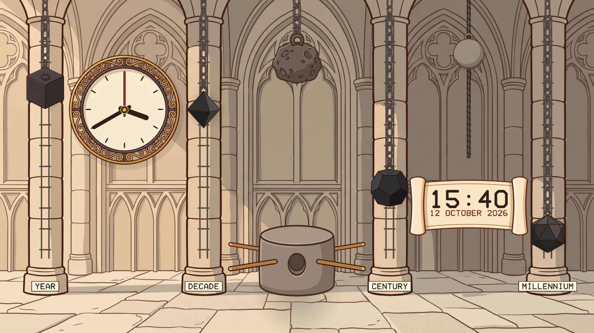
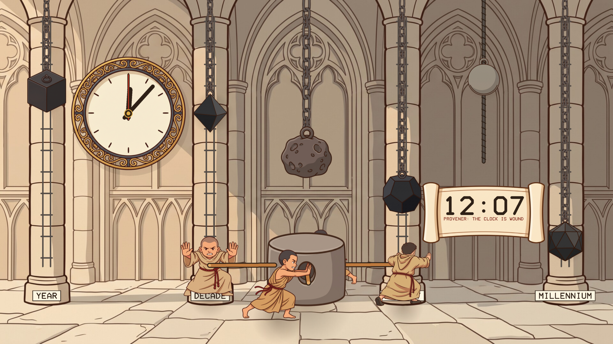
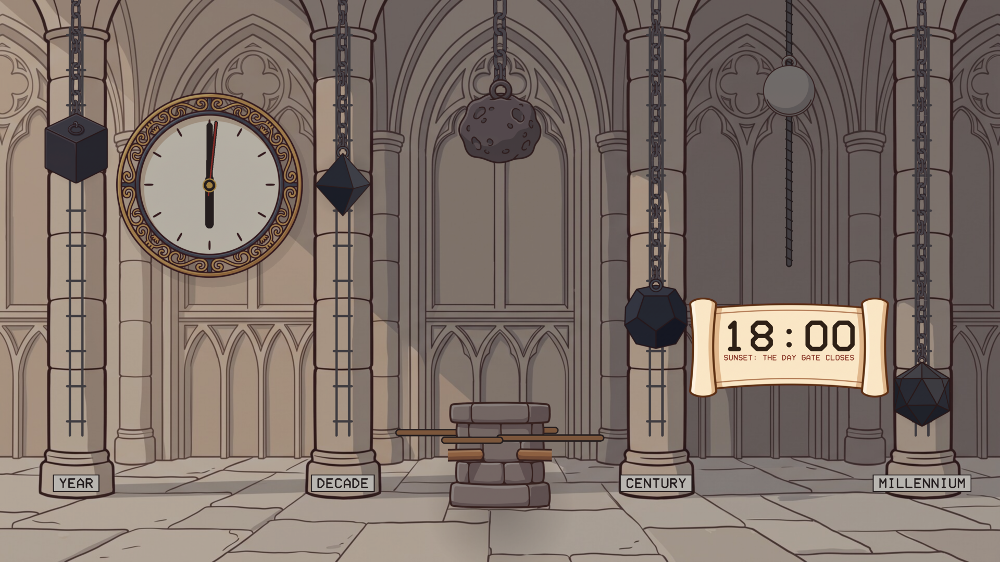
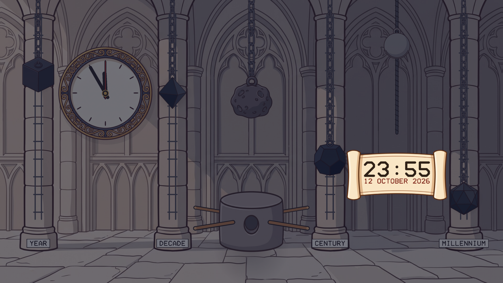
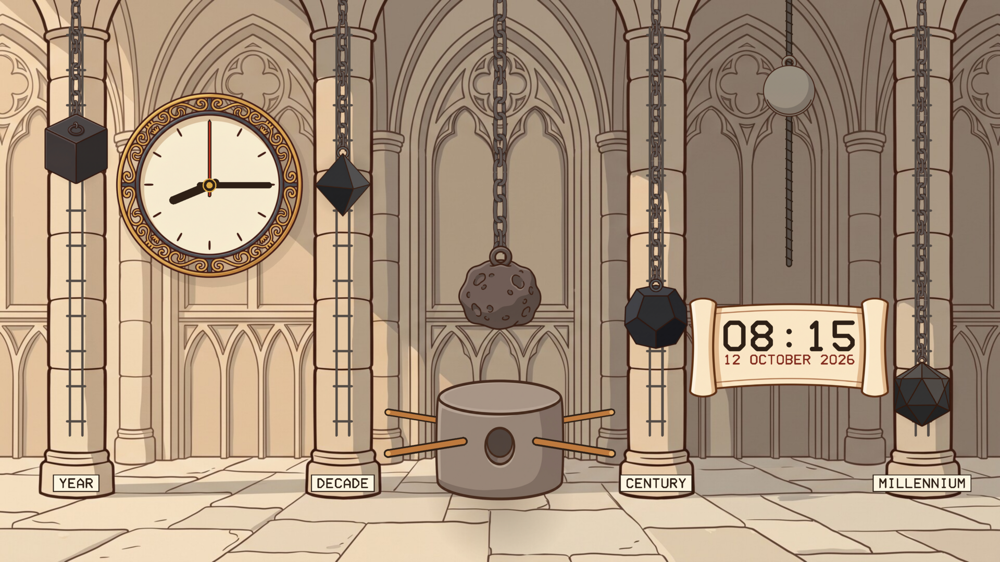

# The Clock of Saunt Edhar

A screensaver of the great clock in the Mynster of the Concent of Saunt Edhar, from
Neal Stephenson's novel *Anathem*. It shows the real time and date. Linux, Windows and macOS. One of the [Anathem screensavers](https://github.com/mottipython/anathem-screensavers).

## How to read it

The chancel is shown as if cut through, and everything is set from your computer's
clock.

- **The meteorite**, in the middle, drives the clock. It is wound to the top at noon
  and sinks through the next twenty-four hours. At sunset and at sunrise it drops
  quickly, because it also works the Day Gate.
- **The four stone weights** ride on rails up the four pillars and tell the date.
  Each creeps upward and falls when its gate opens: the **cube** once a year, the
  **octahedron** once a decade, the **dodecahedron** once a century and the
  **icosahedron** once a millennium. A cube near the top means the year is nearly
  over.
- **The sphere**, on its screw at the upper right, keeps the clock going while it is
  being wound.
- **The dial** and the scroll give the time and date outright.

At noon four fraas put their shoulders to the poles and wind the clock for twenty
minutes. That is the aut of Provener. A capstan only makes sense from above, so
while it lasts a round window opens under the dial and shows them walking it round.
Through the night the chancel goes dark.

Since nobody leaves a screensaver on at noon, every minute or so a whole day is run
through in half a minute, slowing down for sunset, sunrise and Provener, and then
it returns to the real time. `--no-lapse` turns that off.

| | |
|---|---|
|  |  |
| Provener: the clock is wound | Sunset: the Day Gate closes |
|  |  |
| Midnight | Morning, the meteorite low |

### What is from the book and what is not

The meteorite, the four solids and what each one counts, the sphere, the capstan
with its four poles, the twenty minutes of winding, and the fast drops at sunrise
and sunset are all as the book describes. Three things are mine: the weights are
set from our calendar and not Arbre's, sunrise and sunset are fixed at six o'clock,
and the sphere is drawn back up over the two hours after Provener (the book does
not say when).

## Install

Packages are on the [releases page](../../releases).

### Windows

Run `EdharClock-Setup-1.0.2.exe`. It asks for administrator rights, because Windows
only lists screensavers that are in its own system folder. After that "The Clock of
Saunt Edhar" is in Screen Saver Settings with the others, already selected.
Uninstall from Apps.

### macOS

There are two downloads on the releases page, for Apple Silicon and Intel, macOS 11
or later.

**The screen saver** is the file ending `-mac-screensaver.zip`. Unzip it and
double-click the `.saver` file; macOS offers to install it. Then choose it in System
Settings, Screen Saver (scroll to the end of the list, under Other).

**The app** is the file ending `-mac.zip`: the same thing as an ordinary program
that runs full screen until you press a key.

Neither is signed with an Apple developer certificate, so macOS will refuse them at
first. After the refusal, open System Settings, Privacy & Security, scroll down,
and click Open Anyway. If the screen saver still will not load, clear the
quarantine mark in Terminal:

    xattr -dr com.apple.quarantine ~/Library/"Screen Savers"

Both are built on a Mac build machine, where the screen saver is loaded and made to
draw as a test. They have not yet been tried by a person on a real Mac, and screen
savers on recent macOS are known to be temperamental; reports are welcome.

### Linux

**Fedora, Nobara** (built on Fedora 44):

    sudo dnf install ./edhar-clock-1.0.2-1.fc44.x86_64.rpm

**Debian, Ubuntu, Mint** (Ubuntu 24.04 / Debian 13 or later):

    sudo apt install ./edhar-clock_1.0.2_amd64.deb

From your next login it starts by itself after five minutes idle, and any key or
mouse movement ends it. To start the watcher without logging out, or to change the
delay:

    edhar-clock-screensaver enable 10    # after 10 minutes idle
    edhar-clock-screensaver disable
    edhar-clock-screensaver status
    edhar-clock-screensaver now          # run it right away

Wayland desktops have no screensaver service to plug into, so the package starts a
small idle watcher (`swayidle`) at login. It works on compositors that provide the
ext-idle-notify protocol: KDE Plasma, Sway, Hyprland, niri, COSMIC, labwc and
others. GNOME does not provide it, and on X11 you would add `edhar-clock` to
xscreensaver or your desktop's own idle settings. It does not lock the screen. If
one of the other *Anathem* screensavers
([Teglon](https://github.com/mottipython/teglon),
[the Lazy Peregrin](https://github.com/mottipython/lazy-peregrin),
[Cutting the Cake](https://github.com/mottipython/cutting-the-cake)) is already on
screen it stays out of the way.

## Running it yourself

    edhar-clock              full screen on every display; any key or mouse movement quits
    edhar-clock --window     in a window; Esc or Q quits
    edhar-clock --no-lapse   only the real time
    edhar-clock --at 12:05   show it as it would be at that time of day
    edhar-clock --snapshot out.bmp --time 5 --size 1920x1080

## Building

Needs a C compiler, make and SDL2 (2.0.18 or newer). Build from the top of the
source tree, because the pictures in `assets/art` are built into the program.

    make
    make check
    sudo make install

Packages are written to `dist/`. `tools/Containerfile` describes a container with
everything they need:

    podman build -t anathem-build -f tools/Containerfile tools
    podman run --rm --security-opt label=disable -v "$PWD":/src -w /src anathem-build make dist

## Credits and licence

MIT. *Anathem* and the clock are Neal Stephenson's; this is an unofficial fan
project.

The pictures (the chancel, the meteorite, the stone weights, the sphere, the dial,
the hub, the fraas, the floor, the chain and the scroll) were drawn with Google Gemini and
prepared by `tools/make_sprites.py`. Images are decoded with
[stb_image](https://github.com/nothings/stb) (public domain).
